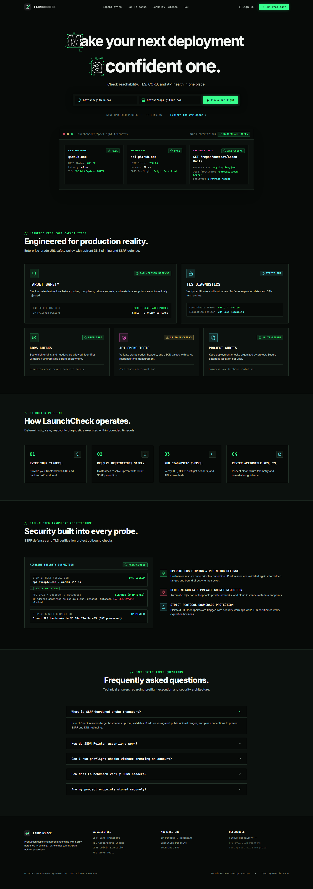
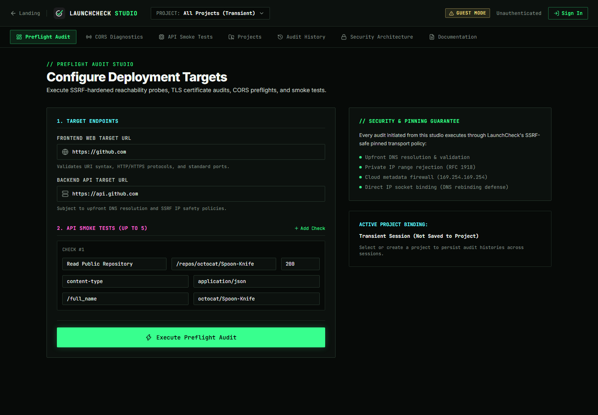
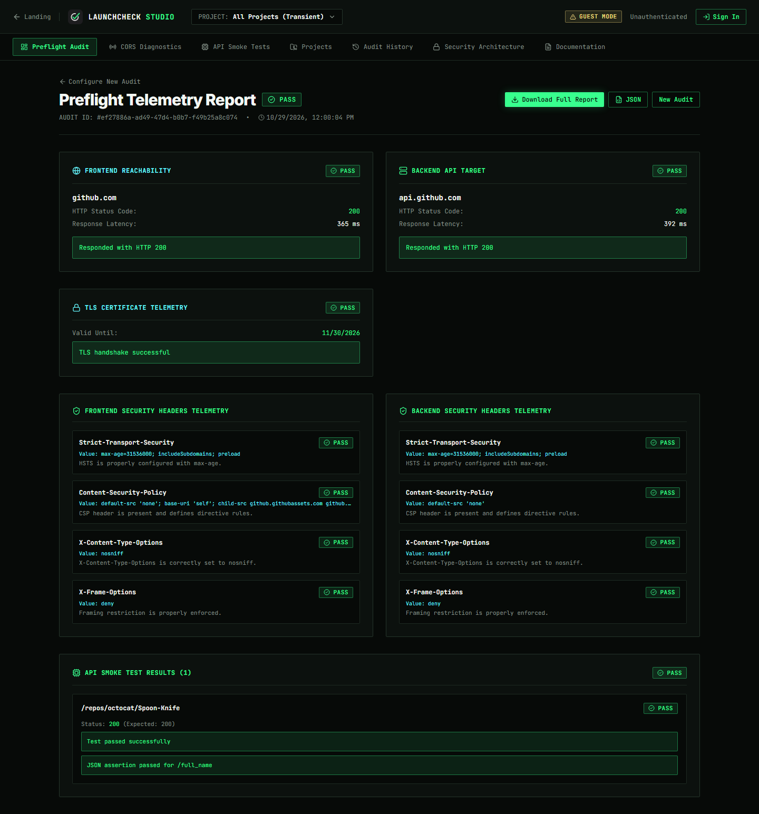
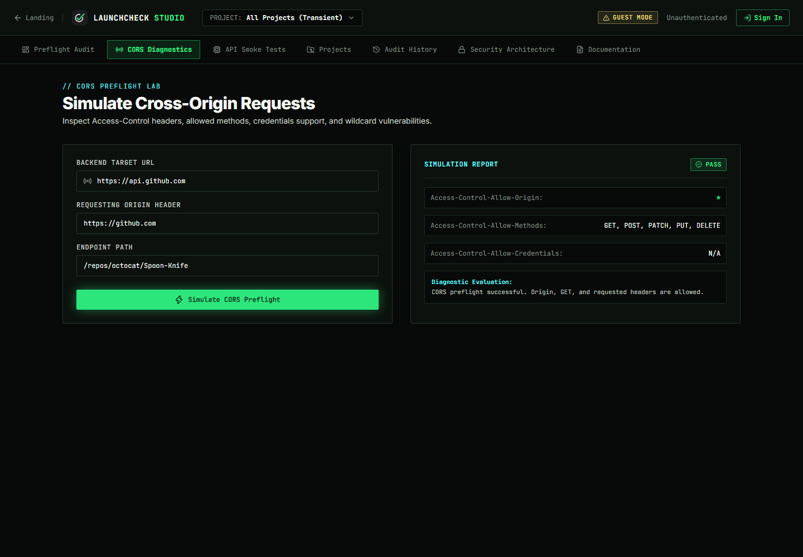
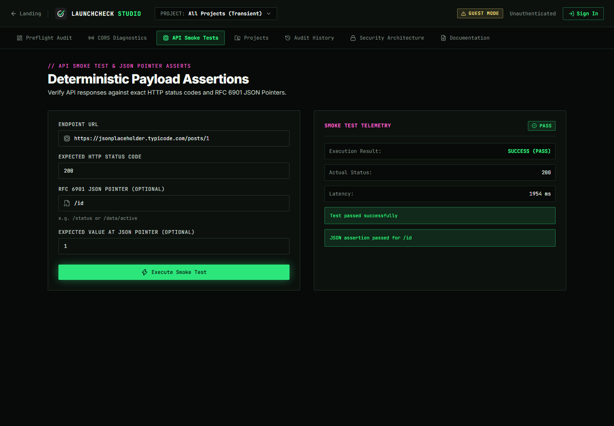
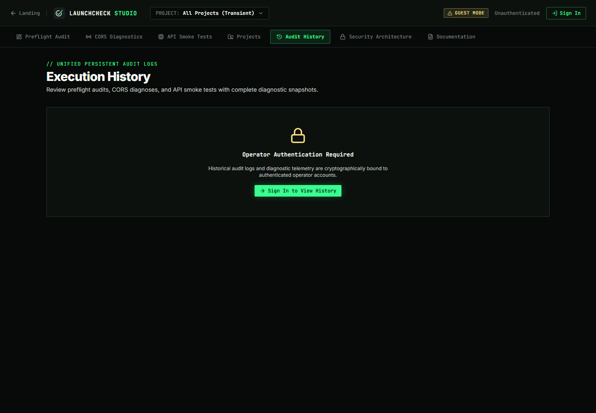
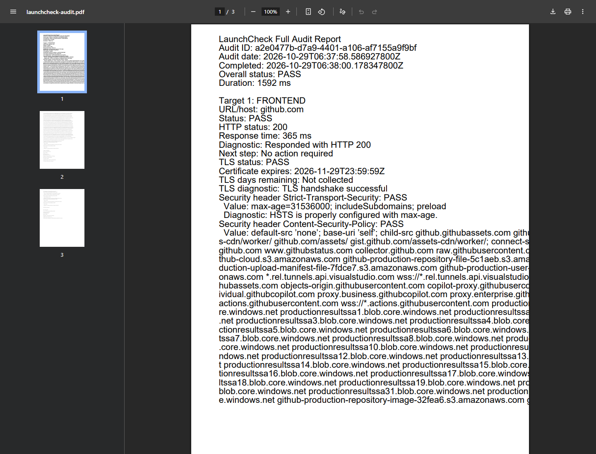
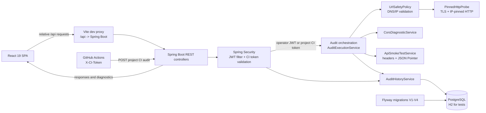

# LaunchCheck

<p align="center">
  
</p>

<h1 align="center">LaunchCheck</h1>

<p align="center">
  Deployment preflight diagnostics for teams that want evidence before release.
</p>

LaunchCheck checks whether a frontend and backend deployment are reachable, safely probeable, correctly configured, and ready for promotion. It combines SSRF-aware HTTP/TLS probing, security-header checks, CORS diagnostics, API smoke tests, project-scoped history, and CI release gates in one full-stack application.

> **Hosted demo:** No public frontend or API deployment is currently configured. Run LaunchCheck locally using the instructions below.

## Contents

- [Why LaunchCheck](#why-launchcheck)
- [Screenshots](#screenshots)
- [Capabilities](#capabilities)
- [Architecture](#architecture)
- [Repository map](#repository-map)
- [Technology stack](#technology-stack)
- [Local development](#local-development)
- [API surface](#api-surface)
- [CI release gates](#ci-release-gates)
- [Security model](#security-model)
- [Testing and quality checks](#testing-and-quality-checks)
- [Documentation](#documentation)
- [Repository status and contribution](#repository-status-and-contribution)

## Why LaunchCheck

A deployment can return HTTP 200 and still be unsafe or incomplete: a certificate may be close to expiry, security headers may be absent, a browser origin may be rejected, or an API response may not match the contract a frontend expects.

LaunchCheck turns those checks into a repeatable audit response with per-check `PASS`, `WARN`, and `FAIL` states, diagnostic messages, and next steps. The same saved project configuration can be run by an authenticated operator or by a project-scoped CI token.

## Screenshots

These screenshots were captured from the local LaunchCheck application at a consistent 1440×1000 viewport. They show the actual product UI and real diagnostic workflows against the public GitHub and JSONPlaceholder endpoints; no mockups or fabricated results are used.

### Product surface



The marketing dashboard presents the deployment preflight workflow, security posture, and supported diagnostics.



The Preflight Audit form is prefilled with the verified GitHub demo targets and a repository smoke test with a JSON Pointer assertion.



A real completed audit showing reachability, HTTP status, TLS certificate expiry, and security-header assessments.

### Diagnostic workspaces



The CORS workspace reports the actual preflight result and returned `Access-Control-Allow-*` headers.



The API smoke-test workspace shows a real HTTP 200 response and a passing RFC 6901 JSON Pointer assertion.



Audit History is intentionally protected behind operator authentication; this captured state demonstrates the access-control boundary rather than an unauthenticated history claim.



The report download was generated from the completed audit result and opened in Chrome's PDF viewer. The rendered capture shows the real paginated report, including audit metadata, target status, TLS telemetry, and security-header details.

## Capabilities

### Deployment and transport diagnostics

- **HTTP/HTTPS reachability:** Probe frontend and backend targets and report status, latency, redirects, and diagnostics.
- **TLS validation and expiry:** Validate the TLS connection, expose certificate expiration timestamps, compute remaining days, and warn within the configured expiry window.
- **Security headers:** Assess HSTS, Content-Security-Policy, X-Content-Type-Options, and X-Frame-Options. Missing or weak headers remain visible as individual warnings rather than disappearing into an overall status.
- **SSRF-aware transport:** Allow only HTTP(S) on ports 80 and 443, reject private and special-use destinations, validate DNS answers, pin sockets to validated public IPs, preserve TLS hostname/SNI validation, and revalidate redirects.

### Application diagnostics

- **CORS diagnostics:** Run a preflight/actual request probe and report the tested origin, endpoint, method, `Access-Control-Allow-*` values, credentials behavior, `Vary`, and diagnostic status.
- **API smoke tests:** Execute configured methods and paths with expected HTTP status, response-header assertions, and RFC 6901 JSON Pointer assertions.
- **Project management:** Save frontend/backend targets in tenant-scoped projects. Project creation and updates reapply the URL safety policy before persistence.
- **Audit history:** Persist project audits and retrieve paginated summaries or full diagnostic snapshots with user/project authorization checks.
- **Reports:** Download the displayed audit result as JSON or a paginated PDF. Exports use the existing result and do not rerun probes; unavailable fields are represented as unavailable.
- **Clear outcomes:** Preserve individual diagnostics, warning messages, TLS findings, security-header values, CORS observations, and smoke-test assertion details alongside the overall result.

### CI integration

- **Project-scoped CI tokens:** Owners create tokens with an optional expiration. Raw tokens are returned once; the backend stores a SHA-256 hash and a safe prefix.
- **CI-triggered audits:** A valid `X-CI-Token` can run the token's bound project using saved URLs only.
- **Release decisions:** `PASS` and `WARN` produce `PROMOTE`; `FAIL` produces `BLOCK`.
- **Separate machine authentication:** CI tokens are evaluated separately from browser JWT sessions and cannot be used for normal project administration.

## Architecture



LaunchCheck is a modular monolith: the frontend is an independent React SPA and the backend owns authentication, authorization, probing, diagnostics, and persistence. The audit engine is shared by public transient audits, authenticated project audits, and CI-triggered audits, while CI execution uses stored project URLs and does not accept URL overrides.

The security boundary is deliberately split. Browser operators authenticate with stateless JWTs; project-scoped CI jobs authenticate with a dedicated `X-CI-Token`. Project and audit lookups are filtered by the authenticated owner or the exact token-bound project. Probes pass through the same SSRF and TLS controls regardless of caller.

## Repository map

```text
LaunchCheck/
├── backend/
│   ├── src/main/java/com/launchcheck/
│   │   ├── auth/                 # Registration, JWT, Spring Security
│   │   ├── project/              # Project CRUD and CI endpoints
│   │   └── audit/                # Probes, safety, diagnostics, history
│   ├── src/main/resources/
│   │   ├── application.yml       # Runtime defaults and env substitutions
│   │   └── db/migration/         # Flyway V1 through V4
│   ├── src/test/java/             # Security, transport, service, and integration tests
│   ├── docker-compose.yml         # Local PostgreSQL service
│   ├── nginx-staging.conf
│   └── pom.xml
├── frontend/
│   ├── src/
│   │   ├── components/           # Marketing and workspace UI
│   │   ├── lib/                  # API client and report exports
│   │   ├── types/                # API response types
│   │   └── tests/                # Vitest and Testing Library suites
│   ├── public/assets/             # Source-served branding assets
│   ├── package.json
│   └── vite.config.ts
├── docs/
│   ├── ARCHITECTURE.md
│   ├── CI.md
│   ├── SECURITY.md
│   ├── PHASE-4.5-ENGINEERING-REPORT.md
│   └── PHASE-4.5-FEATURE-TRACEABILITY.md
├── examples/github-actions/
│   └── launchcheck-release-gate.yml
├── .gitignore
└── README.md
```

Generated `frontend/dist`, `frontend/node_modules`, Maven `target`, caches, and `.git` are intentionally excluded from this overview.

## Technology stack

| Area | Technology | Responsibility |
| --- | --- | --- |
| Frontend | React `^19.3.0` + TypeScript `^5.7.2` | SPA workspace, forms, results, history, and report actions |
| Frontend build | Vite `^8.3.4` | Development server, `/api` proxy, and production bundle |
| Frontend styling | Tailwind CSS `^4.0.0` | UI styling and responsive layout |
| Frontend tests | Vitest `^5.0.5`, Testing Library | Component and report-export regression tests |
| Backend | Java 21, Spring Boot `4.1.2` | REST API, orchestration, validation, and runtime configuration |
| Security | Spring Security starter, BCrypt, HMAC-SHA256 JWT | Operator authentication and authorization |
| Persistence | Spring Data JPA, Hibernate, PostgreSQL | Projects, users, tokens, and audit history |
| Test database | H2 | Isolated backend test execution |
| Migrations | Flyway | Reproducible schema migrations V1–V4 |
| HTTP/TLS | Apache HttpClient 5 | Pinned outbound transport and TLS inspection |
| API documentation | Springdoc OpenAPI `3.1.1` | Swagger/OpenAPI endpoint documentation |

## Local development

### Prerequisites

- Java 21 JDK
- Apache Maven 3.10 or newer
- Node.js 20 or newer and npm 11 or newer
- Docker Desktop, if using the included PostgreSQL service

### Clone the repository

```bash
git clone https://github.com/yashganorkar005/LaunchCheck.git
cd LaunchCheck
```

### Start PostgreSQL

The normal backend configuration expects PostgreSQL on `localhost:5432` with the database and credentials below. The repository includes a Compose definition:

```bash
docker compose -f backend/docker-compose.yml up -d
```

This creates:

- Database: `launchcheck`
- User: `launchcheck`
- Password: `launchcheck`
- Port: `5432`

For a shared or production environment, replace these development credentials through environment variables and do not commit them.

### Start the backend

`backend/src/main/resources/application.yml` defaults to port `8080` and PostgreSQL. The current Vite configuration proxies to `127.0.0.1:8081`, so use the following local command to match the verified worktree setup:

```bash
mvn -f backend/pom.xml spring-boot:run \
  -Dspring-boot.run.arguments="--server.port=8081"
```

Backend URL: `http://127.0.0.1:8081`

If you instead run the backend on its default `8080`, update the Vite proxy target in `frontend/vite.config.ts` to match before starting the frontend. Do not work around a proxy mismatch by weakening CORS.

### Start the frontend

```bash
npm --prefix frontend install
npm --prefix frontend run dev
```

Frontend URL: `http://127.0.0.1:5174`

The Vite development proxy sends relative `/api` requests to the backend. Port `5173` is not the configured LaunchCheck port in this worktree and may belong to another local application.

### Run the demo audit

Open `http://127.0.0.1:5174/`, choose the workspace, and use the prefilled public targets:

- Frontend: `https://github.com`
- Backend: `https://api.github.com`
- Smoke test: `GET /repos/octocat/Spoon-Knife`
- JSON Pointer assertion: `/full_name = octocat/Spoon-Knife`

The public audit endpoint is transient unless an authenticated operator session is active. It does not require a JWT for the basic preflight request.

### Runtime configuration

The backend reads these variables from the environment when supplied:

| Variable | Default in `application.yml` | Purpose |
| --- | --- | --- |
| `SERVER_PORT` | `8080` | Spring Boot HTTP port |
| `SPRING_DATASOURCE_URL` | PostgreSQL localhost URL | JDBC connection |
| `SPRING_DATASOURCE_USERNAME` | `launchcheck` | Database user |
| `SPRING_DATASOURCE_PASSWORD` | `launchcheck` | Database password; replace outside local development |
| `JWT_SECRET` | Development placeholder | HMAC signing secret; set a strong secret outside local development |
| `JWT_EXPIRATION_MS` | `86400000` | JWT lifetime in milliseconds |
| `LAUNCHCHECK_SECURITY_CORS_ALLOWED_ORIGINS` | Profile-dependent | Explicit production browser origins |

There is no committed `.env.example` in the repository. Set variables in the shell, a local untracked environment file, or your deployment platform. Never commit passwords, JWT secrets, CI tokens, or database credentials.

### Troubleshooting

- **Frontend opens but API calls fail:** Confirm the backend is listening on `127.0.0.1:8081` and that the Vite proxy target matches it.
- **`Invalid CORS request`:** Check the browser origin and proxy port. Do not add wildcard CORS; the backend uses explicit development and production origin allowlists.
- **Database connection failure:** Confirm PostgreSQL is running, port `5432` is available, and the datasource variables match the Compose service.
- **Flyway or schema validation failure:** Start with an empty local `launchcheck` database or apply the repository migrations in order; do not disable migrations in a shared environment.
- **Target URL rejected:** LaunchCheck intentionally rejects non-HTTP(S) schemes, non-standard ports, private addresses, metadata ranges, and unsafe DNS answers.

## API surface

All API paths are rooted at `/api/v1`.

| Area | Method and path | Auth | Purpose |
| --- | --- | --- | --- |
| Auth | `POST /auth/register` | Public | Create an operator account |
| Auth | `POST /auth/login` | Public | Return a stateless Bearer JWT |
| Auth | `GET /auth/me` | JWT | Read the current operator |
| Public audit | `POST /audits` | Public; optional JWT | Run a transient preflight audit |
| CORS | `GET /audits/cors` | Public; optional JWT | Run CORS diagnostics |
| Smoke | `POST /audits/smoke` | Public; optional JWT | Run a single smoke check |
| User history | `GET /audits/history` | JWT | List authenticated-user audit summaries |
| History detail | `GET /audits/history/{id}` | JWT | Retrieve a full authorized audit snapshot |
| History record | `DELETE /audits/history/{id}` | JWT | Delete one authorized record |
| History | `DELETE /audits/history` | JWT | Clear the authenticated user's history |
| Projects | `POST /projects` | JWT | Create an SSRF-validated project |
| Projects | `GET /projects` | JWT | List owned projects |
| Projects | `GET /projects/{id}` | JWT | Read one owned project |
| Projects | `PUT /projects/{id}` | JWT | Update an owned project |
| Projects | `DELETE /projects/{id}` | JWT | Delete an owned project |
| Project audit | `POST /projects/{id}/audits` | JWT | Run and persist a project audit |
| Project history | `GET /projects/{id}/audits` | JWT | List bounded project history |
| CI token | `POST /projects/{id}/ci-tokens` | JWT | Create a project-scoped token; raw value is returned once |
| CI audit | `POST /projects/{id}/ci/audits` | `X-CI-Token` | Run a stored-project audit and return `PROMOTE` or `BLOCK` |

Swagger UI is available at `/swagger-ui.html` when the backend is running. The repository does not currently contain a separate `docs/API.md`; the controller routes and OpenAPI endpoint are the authoritative API references.

## CI release gates

Create a project-scoped token as an authenticated project owner, store the one-time raw value as a GitHub Actions secret named `LAUNCHCHECK_CI_TOKEN`, and configure the API URL and project ID as secrets. The maintained example is [`examples/github-actions/launchcheck-release-gate.yml`](examples/github-actions/launchcheck-release-gate.yml).

The CI endpoint reads the saved project URLs and does not accept target overrides:

```bash
curl -sS -X POST "$LAUNCHCHECK_API_URL/api/v1/projects/$PROJECT_ID/ci/audits" \
  -H "X-CI-Token: $LAUNCHCHECK_CI_TOKEN" \
  -H "Content-Type: application/json"
```

Decision behavior is explicit:

- `PASS` or `WARN` audit result → `releaseDecision: "PROMOTE"`
- `FAIL` audit result → `releaseDecision: "BLOCK"`

The current controller exposes token creation and CI audit execution. Token revocation exists in the service layer but is not currently wired as a public controller route; do not document or automate an HTTP revoke endpoint. See [`docs/CI.md`](docs/CI.md) for the complete token lifecycle and limitations.

## Security model

LaunchCheck treats target URLs and client inputs as hostile:

- Only `http` and `https` schemes and standard ports 80/443 are accepted.
- Loopback, private, link-local, multicast, reserved, IPv4-mapped IPv6, and cloud metadata destinations are rejected.
- DNS answers are validated before connection, and outbound sockets are pinned to validated IPs to reduce DNS-rebinding risk.
- Redirects are bounded, revalidated, and cannot downgrade HTTPS to HTTP.
- TLS hostname verification and SNI remain enabled.
- Passwords are BCrypt-hashed; JWTs are signed and expire.
- Project and history operations enforce owner-plus-entity authorization.
- CI tokens are project-bound, hashed at rest, expiration-aware, and separate from JWT authentication.
- Audit and report exports exclude credential-like fields and do not rerun probes.

Read the detailed controls in [`docs/SECURITY.md`](docs/SECURITY.md) and the architecture rationale in [`docs/ARCHITECTURE.md`](docs/ARCHITECTURE.md).

## Testing and quality checks

Run the backend suite:

```bash
mvn -f backend/pom.xml test
```

Run the frontend suite:

```bash
npm --prefix frontend test
```

Build the frontend production bundle:

```bash
npm --prefix frontend run build
```

The backend tests cover authentication, project isolation, SSRF policy, pinned transport, TLS expiry boundaries, CORS configuration, audit history, CI token lifecycle, and CI release decisions. The frontend tests cover the workspace flows, TLS rendering, design-system behavior, audit report exports, credential filtering, PDF pagination, and demo defaults.

The latest verified frontend run in this worktree passed **20 tests across 6 files**, and the production build completed successfully with an existing chunk-size warning. The latest documented backend engineering checkpoint reports **58 tests passing**; run the command above for fresh results in your environment.

## Documentation

- [`docs/ARCHITECTURE.md`](docs/ARCHITECTURE.md) — module responsibilities, data flow, and tenant isolation.
- [`docs/SECURITY.md`](docs/SECURITY.md) — SSRF, transport, authentication, authorization, and privacy controls.
- [`docs/CI.md`](docs/CI.md) — CI token lifecycle, endpoint contract, and release decisions.
- [`docs/PHASE-4.5-ENGINEERING-REPORT.md`](docs/PHASE-4.5-ENGINEERING-REPORT.md) — engineering verification record and evidence classification.
- [`docs/PHASE-4.5-FEATURE-TRACEABILITY.md`](docs/PHASE-4.5-FEATURE-TRACEABILITY.md) — feature-to-code and test traceability.
- [`examples/github-actions/launchcheck-release-gate.yml`](examples/github-actions/launchcheck-release-gate.yml) — minimal GitHub Actions release-gate example.

Deployment-specific documentation such as `docs/DEPLOYMENT.md` and `docs/ENVIRONMENT.md` is not currently present. The Compose database definition and runtime configuration in `backend/docker-compose.yml` and `backend/src/main/resources/application.yml` are the available deployment references.

## Repository status and contribution

This repository is maintained as a full-stack engineering project. Before opening a change:

1. Keep credentials and environment files out of commits.
2. Do not commit generated `frontend/node_modules`, `frontend/dist`, or Maven `target` output.
3. Add or update focused tests for behavior changes.
4. Run the backend tests, frontend tests, and frontend build when relevant.
5. Preserve the SSRF, authorization, CORS, TLS, and CI-token boundaries.

No license file is currently present, so the project should not be treated as licensed for unrestricted reuse until a license is added.
